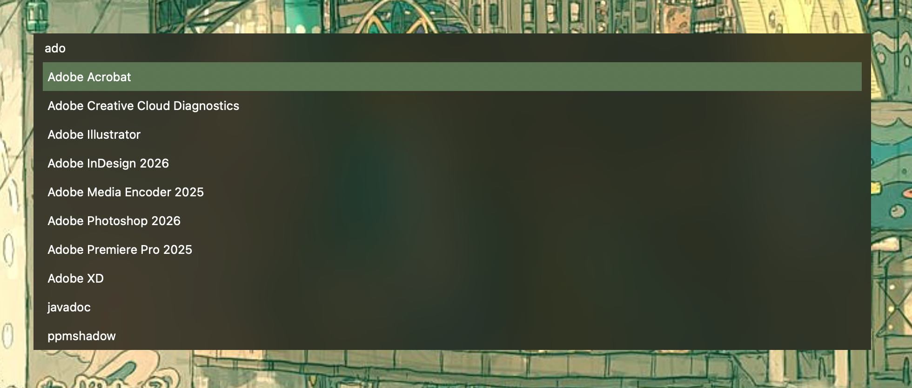

# dmenu-mac — personal fork

A personal fork of [dmenu-mac](https://github.com/oNaiPs/dmenu-mac), the
keyboard-driven macOS launcher by [oNaiPs](https://github.com/oNaiPs).

## What changed

Based on upstream **0.9.0**, this fork adds the following features. Configure
them in **Settings → Appearance** (**⌘,**). Settings persist between launches;
**Reset to Defaults** restores the original appearance.

### Centered launcher

Set **Position** to **Center** to place the launcher in the middle of the
selected screen's usable area. **Top** and **Bottom** remain available, with
**Top** as the default.

### Adjustable width

Turn off **Full width** and adjust **Width** from 300 to 3,000 points, initially
900. Custom width works at every position, stays centered horizontally and
shrinks to fit the screen while avoiding a side Dock. Full width remains the default.

### Vertical results

Choose **Vertical** to stack results below the search field, with 3 to 20 visible
rows (initially 10). **↑/↓** or **Tab/Shift+Tab** select results; **←/→** edit the
query. The list keeps the selection visible and its height stays fixed while
filtering, growing with the font to fit within the screen. **Horizontal** remains the default.

### Background blur

Enable **Blur background** for native macOS blur behind the launcher, with text
and icons staying sharp in both layouts. **Window background** and **Tint opacity**
adjust the color overlay; lower opacity reveals more of the blur. Blur is off
by default, and macOS controls its strength and honors **Reduce transparency**.

## Installation

No fork binaries have been released. Homebrew and Nix install the upstream app;
build this fork from source to use these controls.

See the [upstream README](https://github.com/oNaiPs/dmenu-mac#readme) for usage
and [development notes](docs/development.md) for building and testing this fork.

## Credits

- [oNaiPs](https://github.com/oNaiPs) and the upstream contributors: original application.
- [flowrange](https://github.com/flowrange): fork and validation on macOS.
- [Codex](https://github.com/openai/codex): development assistance.

[GPL-3.0](LICENSE). Original copyright notices are retained.
